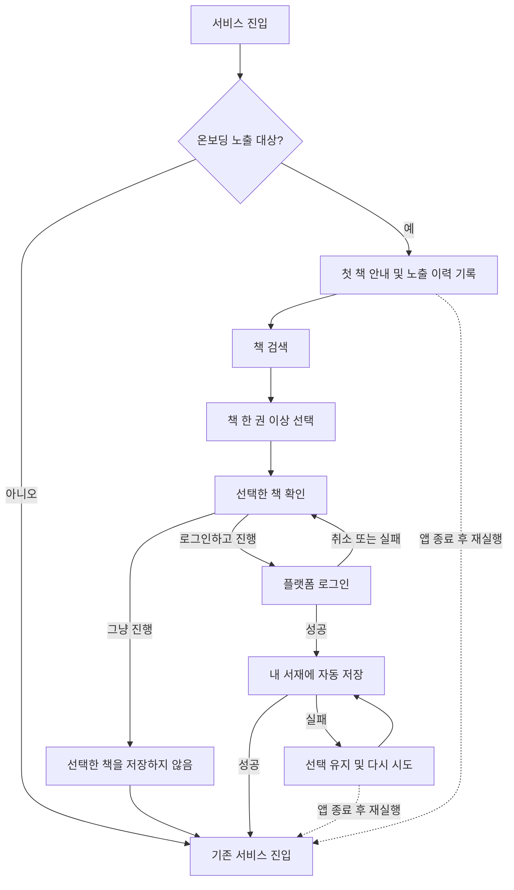

# 첫 책 선택 온보딩

## 목적과 상태

Android와 iOS의 첫 방문자가 책을 검색해 한 권 이상 선택하도록 안내한다. 마지막에 로그인하면 선택한 책을 내 서재에 자동 저장하고, 로그인하지 않고 진행하면 저장 없이 서비스에 진입한다.

- 결정일: 2026-10-14
- 근거: 사용자 인터뷰 `interview_20261014_063746`와 이후 확인 답변
- 이번 산출물: 요구사항 문서와 Figma 화면 시안
- 상태: 동작 요구사항 확정, 화면 구성과 문구는 검토용 시안
- 앱 코드, 서버 API, 배포 및 실제 로그인 연결은 이번 작업 범위에 포함하지 않는다.

## 확정한 동작

| 상황 | 동작 |
| --- | --- |
| 적용 플랫폼 | Android와 iOS |
| 노출 대상 | 처음 방문한 사용자. 기존 사용자의 서재가 비어 있다는 이유로 노출하지 않는다. |
| 노출 기준 | 설치가 아닌 사용자 기준으로 한 번 노출한다. 식별 가능한 사용자는 재설치하거나 기기를 바꿔도 다시 노출하지 않는다. |
| 비로그인 사용자 식별 불가 | 동일 사용자인지 확인할 수 없으면 다시 노출해도 된다. |
| 온보딩 진행 | 실제 책을 검색하고 한 권 이상 선택해야 마지막 진행 선택 단계로 넘어간다. 책 선택 전에 건너뛰기 버튼을 제공하지 않는다. |
| 로그인 전 책 선택 | 선택 목록에만 담는다. 비로그인 사용자의 실제 서재에는 저장하지 않는다. |
| 로그인하고 진행 | 인증 성공 후 선택한 책을 내 서재에 자동 저장한다. 저장 버튼을 다시 누르게 하지 않는다. |
| 그냥 진행 | 선택한 책을 저장하지 않고 서비스에 진입한다. |
| 로그인 취소 또는 실패 | 선택한 책을 유지한다. 로그인하고 진행 또는 그냥 진행을 다시 선택할 수 있다. |
| 로그인 성공 후 저장 실패 | 현재 온보딩 흐름에서는 저장에 성공할 때까지 재시도해야 진입한다. 저장 없이 진입하는 버튼은 제공하지 않는다. |
| 온보딩 도중 앱 종료 후 재실행 | 한 번 노출했으면 완료 여부와 관계없이 서비스에 바로 진입한다. |
| 저장 실패 후 앱 종료·재실행 | 예외 없이 서비스에 바로 진입한다. 미완료 저장 때문에 재진입을 막지 않는다. |

책 선택 의무는 현재 온보딩 화면 안의 진행 조건이다. 앱 종료 후 재실행까지 제한하거나, 모든 진입 전에 책 저장을 보장하는 조건이 아니다. 노출 이력, 임시 선택 목록, 실제 서재 저장 결과는 서로 구분한다.

## 사용자 흐름

## 화면 시안 범위

아래 화면 구성과 문구는 확정 동작을 표현하기 위한 제안이다. 화면 간 흐름은 문서와 캔버스 주석으로 설명한다. 실제 검색, 인증, 저장 기능이나 클릭형 프로토타입은 연결하지 않았다.

| ID | 화면 또는 상태 | 주요 내용 |
| --- | --- | --- |
| ONB-01 | 첫 책 안내 | 빈 서재 미리보기, 첫 책을 고르는 이유, 책 찾기 |
| ONB-02 | 검색 전 | 검색 입력, 책 한 권 이상 선택 안내, 비활성 다음 버튼 |
| ONB-03 | 검색 결과 | 표지·제목·저자, 선택 전 책 목록 |
| ONB-04 | 책 선택 완료 | 선택 표시, 선택 개수, 활성 다음 버튼 |
| ONB-05 | 선택한 책 확인 | 선택한 책의 서재 미리보기, 로그인하고 진행, 그냥 진행, 저장 여부 안내 |
| ONB-06 | Android 로그인 | 기존 Google 로그인 컨트롤, 닫으면 선택 유지 |
| ONB-07 | iOS 로그인 | 기존 Apple·Google 로그인 컨트롤, 닫으면 선택 유지 |
| ONB-08 | 로그인 실패 후 복귀 | 선택한 책 유지, 실패 안내, 두 진행 선택지 재제공. 취소 시에는 오류 안내 없이 ONB-05로 복귀 |
| ONB-09 | 자동 저장 중 | 로그인 완료, 선택한 책 저장 중 표시, 중복 요청 방지 |
| ONB-10 | 저장 실패 | 선택 유지, 실패 안내, 다시 시도. 현재 흐름에서 저장 없이 진입 불가 |
| ONB-11 | 검색 결과 없음 | 검색어 수정 안내, 검색 입력 유지 |
| ONB-12 | 검색 실패 | 검색어 유지, 오류 안내, 다시 시도 |
| ONB-13 | 좁은 화면 검토 | 320 너비에서 선택 확인 및 두 진행 선택지 배치 확인 |

검색 결과와 미리보기의 책 데이터는 Figma 기존 자산을 재사용한 예시다. 실제 검색 순위나 사용자 서재 데이터가 아니다. 성공 또는 그냥 진행 이후 도착 화면은 기존 서비스 진입 흐름에 연결하며 새로운 홈 화면을 설계하지 않는다.

## 디자인 기준

### 제작한 Figma 시안

- [전체 시안 보드](https://www.figma.com/design/tn59Thk2GRcVLkzoO8k9Sr?node-id=1074-3)
- [첫 책 안내부터 진행 선택까지, ONB-01~05](https://www.figma.com/design/tn59Thk2GRcVLkzoO8k9Sr?node-id=1074-10)
- [Android·iOS 로그인과 저장 상태, ONB-06~10](https://www.figma.com/design/tn59Thk2GRcVLkzoO8k9Sr?node-id=1074-13)
- [검색 예외와 320 너비, ONB-11~13](https://www.figma.com/design/tn59Thk2GRcVLkzoO8k9Sr?node-id=1074-16)
- [책 선택 행 메인 컴포넌트 세트](https://www.figma.com/design/tn59Thk2GRcVLkzoO8k9Sr?node-id=1073-387): Default, Selected
- [서재 미리보기 메인 컴포넌트 세트](https://www.figma.com/design/tn59Thk2GRcVLkzoO8k9Sr?node-id=1073-407): Empty, Selected
- [Controls의 온보딩 상태별 연결 인스턴스](https://www.figma.com/design/tn59Thk2GRcVLkzoO8k9Sr?node-id=1073-408)

### 재사용한 원본과 스타일

- 원본: [책췍 Figma](https://www.figma.com/design/tn59Thk2GRcVLkzoO8k9Sr)
- 공통 컴포넌트와 토큰: [디자인 시스템](https://www.figma.com/design/tn59Thk2GRcVLkzoO8k9Sr?node-id=901-300)
- 공통 상태별 예시: [Controls](https://www.figma.com/design/tn59Thk2GRcVLkzoO8k9Sr?node-id=905-153)
- 화면 레이아웃 참고: [발견](https://www.figma.com/design/tn59Thk2GRcVLkzoO8k9Sr?node-id=822-1084), [내 서재](https://www.figma.com/design/tn59Thk2GRcVLkzoO8k9Sr?node-id=822-1225)
- 로그인 참고: [iOS 로그인](https://www.figma.com/design/tn59Thk2GRcVLkzoO8k9Sr?node-id=925-204)
- 일반 텍스트는 Gowun Dodum Regular, 문자 아이콘은 Pretendard를 사용한다. 공급업체 로그인 컨트롤은 기존 자산의 서체·로고·색상을 유지한다.
- 흰 배경, 검정 주요 버튼, 주황 강조색, 좌우 24 여백 및 기존 변수·텍스트 스타일을 재사용한다.
- 선택 목록과 서재 미리보기는 저장 완료처럼 표현하지 않는다. 로그인 전에는 아직 저장되지 않았음을 안내한다.
- 기본 시안은 기존 모바일 원본과 같은 390 너비이며, 별도 320 너비 시안으로 좁은 화면을 검토한다.

### 공급업체 로그인 버튼 제약

Apple과 Google 버튼은 앱 공통 버튼으로 다시 그리지 않고 각 공급업체 규격을 따른다. 두 버튼의 모서리 반경이 서로 달라야 한다는 규칙은 없으며, iOS 앱에서는 둘 다 8pt로 통일할 수 있다.

- Apple: 실제 앱은 공식 `ASAuthorizationAppleIDButton`의 검정색 Continue 유형을 사용한다. Apple이 허용하는 외형 변경은 제공된 유형과 스타일 선택, `cornerRadius` 조정이며, 그 밖의 내부 로고, 문구, 색상, 글꼴은 변경하지 않는다. 현재 구현은 `cornerRadius = 8.0`과 Compose 외곽 `RoundedCornerShape(8.dp)`를 사용한다. Figma의 Apple 컴포넌트가 0으로 보이는 것은 공식 샘플 이미지를 그대로 배치한 시안 자산의 값이며, 공급업체가 강제한 모서리 값이 아니다. 근거: [Apple 공식 버튼 문서](https://developer.apple.com/documentation/authenticationservices/asauthorizationappleidbutton), `android/shared/src/iosMain/kotlin/com/chaekchaek/app/ui/common/AppleSignInButton.ios.kt`
- Google: 공식 SDK 렌더 버튼 사용을 권장하지만, 공식 자산 또는 커스텀 버튼도 허용한다. 커스텀 버튼은 표준 색상의 G 로고, 허용 문구, 색상, 글꼴, 크기와 내부 여백 등 현재 브랜드 가이드를 따라야 한다. 현재 iOS 구현은 SDK 기본 버튼 화면을 그대로 쓰지 않고 `GoogleSignInControl`을 직접 그리며 모서리 반경을 8pt로 설정한다. 근거: [Google 로그인 브랜드 가이드](https://developers.google.com/identity/branding-guidelines), `android/iosApp/Chaekchaek/ContentView.swift`
- 공통 적용: 버튼 높이와 너비, 화면 안의 외부 배치 및 8pt 모서리 통일은 가능하다. 공급업체가 소유한 내부 자산은 책췍 공통 버튼 스타일로 덮어쓰지 않는다.

2026-10-15 확인 기준으로 현재 Google 커스텀 컨트롤은 `Roboto-Bold 17`을 사용한다. 최신 Google 브랜드 가이드와 배포 시점의 공식 자산을 다시 대조하기 전에는 이 구현이 최신 규격을 모두 충족한다고 판단하지 않는다.

## 구현 단계에서 확인할 항목

아래는 새 사용자 요구가 아니라 확정 동작을 구현하기 위해 확인할 기술 사항이다.

- 계정별 노출 이력의 원본과 기존 사용자 판별 근거를 확인한다. 새 플래그가 없다는 사실만으로 기존 사용자를 첫 방문자로 분류하지 않는다.
- 비로그인 상태의 같은 기기 내 노출 이력과, 인증 후 계정 이력 연결을 구분한다. 식별할 수 없는 비로그인 사용자의 재노출은 허용한다.
- 로그인 화면을 다녀오는 동작을 앱 신규 실행으로 오인해 선택을 버리지 않는다.
- 실제 서재 추가 API의 인증·중복 처리·부분 성공을 확인하고, 재시도 시 이미 저장한 책을 중복 추가하지 않는다.
- 기존 서재 추가 동작을 재사용한다. 독서 상태나 저장 API 계약을 이번 시안에서 새로 정의하지 않는다.
- 이미 로그인된 최초 방문자의 화면 분기는 기존 인증 상태를 확인해 불필요한 재인증 없이 같은 자동 저장 결과로 연결할 수 있는지 구현 단계에서 확인한다.
- Figma 내 공급업체 버튼은 배치 참고용이다. 실제 앱에서는 공급업체 네이티브 컨트롤과 기존 인증 흐름을 사용한다.

## 검증 기준

### 이번 문서·시안

- 확정 동작과 화면별 버튼·문구의 일치 여부
- 새 공통 요소의 메인 컴포넌트 및 Controls 인스턴스 연결
- 기존 버튼·검색창·표지·로그인 컴포넌트, 변수와 스타일 재사용
- 편집 가능한 레이어 구성, 글꼴, 잘림·겹침, 390 및 320 너비 캡처

2026-10-14 확인 결과:

- 390×844 시안 12개와 320×844 시안 1개를 제작했다.
- 세 화면 묶음의 캡처를 확인했다. 선택 미리보기의 문구와 좁은 화면 구분선을 수정한 뒤 해당 화면과 공통 레퍼런스를 다시 캡처해 확인했다.
- 13개 화면의 표시된 텍스트·인스턴스 경계를 검사했으며 화면 밖으로 넘어가는 항목은 없었다. 캡처에서 주요 동작 영역의 잘림·겹침이 없는 것을 확인했다.
- 일반 텍스트 Gowun Dodum Regular, 문자 아이콘 Pretendard Regular, 기존 Google 컨트롤의 Roboto Bold를 확인했다.
- Controls의 네 인스턴스가 각각 책 선택 행 두 상태와 서재 미리보기 두 상태의 메인 컴포넌트를 참조하는 것을 확인했다.
- 화면은 편집 가능한 텍스트, 자동 배치 프레임과 컴포넌트 인스턴스로 구성했다. 책 표지와 기존 공급업체 자산은 이미지를 재사용했다.

### 이후 구현

- 책 0권일 때 다음 단계 불가, 1권 이상일 때 진행 가능
- 로그인 성공 시 자동 저장 후 진입, 그냥 진행 시 서재 저장 요청 없음
- 로그인 취소·실패 시 선택 유지 및 두 선택지 복귀
- 저장 실패 시 현재 흐름의 진입 제한과 재시도 동작
- 온보딩 중 종료 및 저장 실패 후 재실행 시 바로 진입
- 사용자별 재노출 제한과 식별 불가능한 비로그인 예외
- Android와 iOS의 실제 인증·저장 흐름, 접근성 및 기기 화면 검증

Figma 시안 검증은 앱 실행, API 반영, 기기 접근성 검증 또는 팀 라이브러리 게시의 증거가 아니다.
