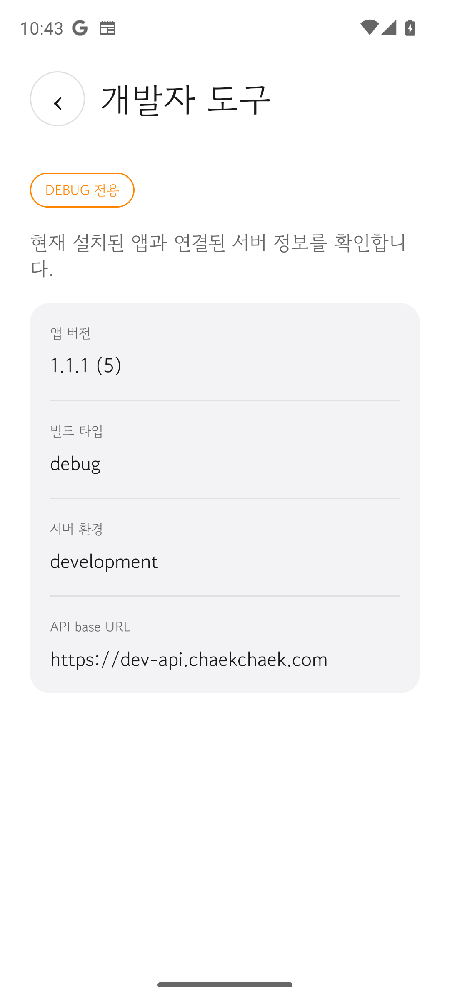
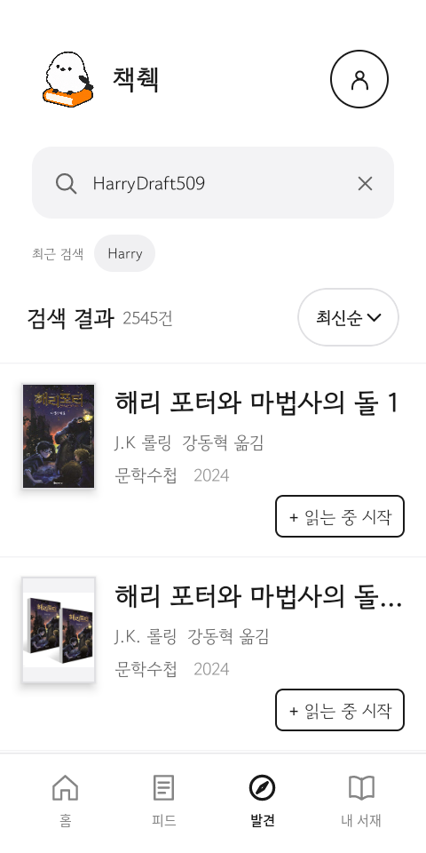
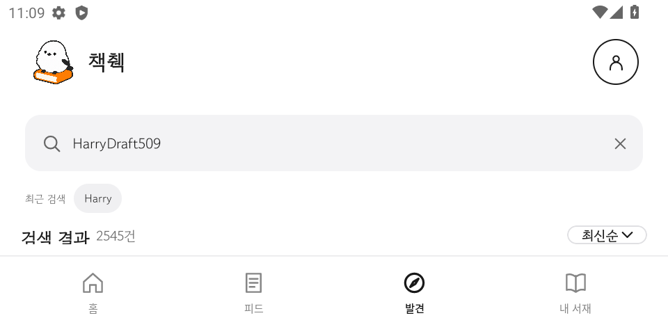
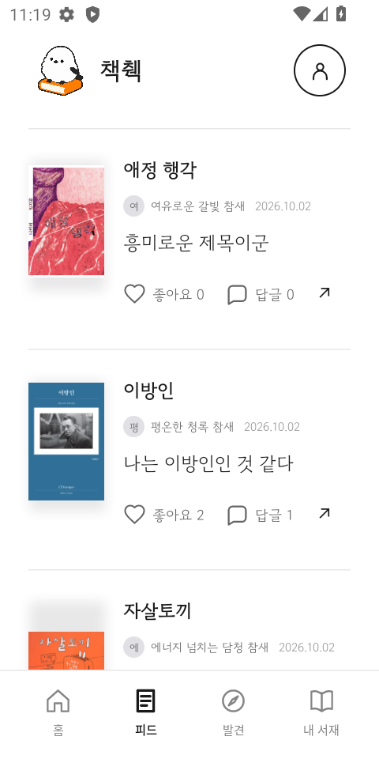
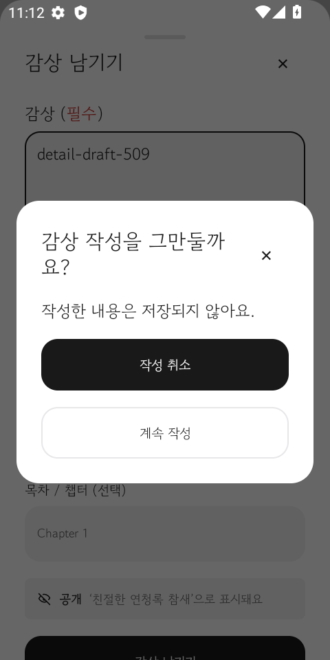
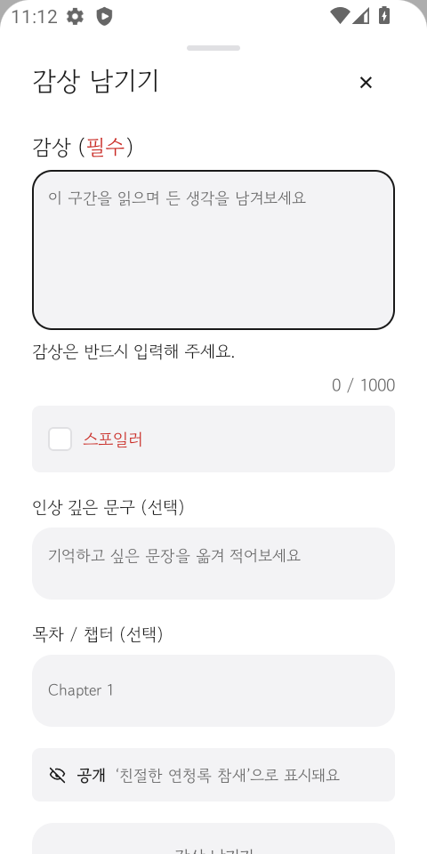

# Android 개발자 도구와 상태 보존 요구사항 제출 문서

2026-10-15 기준. Android 앱에 개발자 도구와 상태 보존 요구사항을 적용한 결과를 정리한다.

- 개발자 도구: [이슈 #507](https://github.com/woowacourse-teams/2026-chaekchaek/issues/507), [PR #508](https://github.com/woowacourse-teams/2026-chaekchaek/pull/508)
- 상태 보존: [이슈 #509](https://github.com/woowacourse-teams/2026-chaekchaek/issues/509), [PR #510](https://github.com/woowacourse-teams/2026-chaekchaek/pull/510)
- 상태 보존 상세 기록: [Android 상태 보존 구현 기록](../android-state-preservation-handoff.md)

두 PR은 2026-10-15에 `an-develop`에 병합됐고 각 PR의 `Build, test, lint`가 통과했다.

## 제출용 요약

개발 과정에서 앱 버전, 빌드 타입과 연결된 서버를 화면에서 확인하기 어려웠고, 발견·피드·도서 상세에서는 구성 변경이나 시스템의 백그라운드 프로세스 종료 후 사용자의 입력과 탐색 위치가 사라졌다. 이를 해결하기 위해 debug 소스셋에만 개발자 도구 화면을 추가하고, 세 화면의 상태를 수명과 크기에 따라 ViewModel, Saved State, Persistent Storage로 나눴다.

개발자 도구에서는 실제 빌드와 API 설정을 읽어 `versionName`, `versionCode`, 빌드 타입, 서버 환경, API base URL을 표시한다. release APK의 Manifest, 리소스, 파일과 DEX를 검사해 개발자 도구 식별자와 코드가 포함되지 않은 것을 확인했다.

상태 보존은 큰 서버 응답을 저장하지 않고 ViewModel에서 캐시하며, 프로세스 복원에 필요한 검색어·정렬·페이지·ID·목록 위치·입력 초안만 Saved State에 둔다. 화면을 닫거나 앱을 새로 시작해도 남아야 하는 최근 검색어만 기존 SharedPreferences에 유지한다. 복원 시 서버에서 최신 데이터를 다시 조회하고 등록·좋아요·삭제·제출 같은 쓰기 작업은 자동으로 다시 실행하지 않는다.

## 요구사항 1. debug 전용 개발자 도구

### 문제 상황

원격 설정이나 서버 환경을 바꾼 뒤 앱에 적용됐는지 확인하려면 캐시 만료를 기다리거나 앱을 다시 설치해야 했다. 현재 앱이 development와 production 중 어느 서버에 연결됐는지, 어떤 버전과 빌드 타입인지도 화면만 보고 판단하기 어려웠다. 확인 비용이 높아질수록 검증을 생략할 가능성이 커졌다.

개발용 UI를 일반 코드에 넣고 `BuildConfig.DEBUG` 조건으로 숨기는 방식은 release 화면에서만 보이지 않을 뿐, 배포 결과물에 코드와 리소스가 남을 수 있다. 따라서 진입점과 구현 자체를 빌드 변형별로 분리할 필요가 있었다.

### 적용 내용

`app/src/debug`에 홈의 `DEV` 진입 버튼, `DeveloperToolsActivity`, 문자열과 Manifest 등록을 배치했다. `app/src/release`의 `MainActivity`에는 개발자 도구 참조가 없다. 인증, 저장소, 분석과 공통 앱 조립은 `ChaekchaekActivity`에 두고 debug와 release 진입점에서 빌드별 UI만 조립한다.

개발자 도구 화면은 다음 값을 추정하지 않고 실제 설정에서 읽는다.

| 표시 항목 | 원본 |
| --- | --- |
| 앱 버전 | `BuildConfig.VERSION_NAME` |
| versionCode | `BuildConfig.VERSION_CODE` |
| 빌드 타입 | `BuildConfig.BUILD_TYPE` |
| 서버 환경 | `ApiConfiguration.environment` |
| API base URL | `ApiConfiguration.current.baseUrl` |

홈 데이터가 로딩 중이거나 비어 있거나 실패한 경우에도 개발자 도구에 들어갈 수 있도록 상단 진입점을 상태 본문과 분리했다. 오류 화면에서는 개발자 도구 진입과 홈 재시도를 각각 수행할 수 있다.

구현 전에 책췍 Figma와 디자인 시스템을 확인하고 다음 시안을 파일 안에 등록했다.

- [debug 홈 진입 상태](https://www.figma.com/design/tn59Thk2GRcVLkzoO8k9Sr?node-id=1099-5)
- [개발자 도구 화면](https://www.figma.com/design/tn59Thk2GRcVLkzoO8k9Sr?node-id=1099-174)

### 적용 전후

| 적용 전 | 적용 후 |
| --- | --- |
| 화면에서 앱 버전과 연결 서버를 함께 확인할 수 없었다 | debug 홈에서 개발자 도구를 열어 한 화면에서 확인한다 |
| 빌드 타입으로 서버 환경을 추정해야 했다 | 실제 API 요청 설정의 환경과 base URL을 표시한다 |
| 개발용 기능이 일반 코드에 섞일 수 있었다 | 화면, 진입점, 리소스와 Manifest를 debug 소스셋에 둔다 |
| 홈 데이터가 준비돼야 진입 UI를 노출할 수 있었다 | 로딩·빈 상태·실패 상태에서도 진입점을 유지한다 |

### 검증

- development debug APK를 Pixel 6a API 33 에뮬레이터에 설치했다. 홈의 `DEV` 버튼으로 진입하고 시스템 뒤로가기로 홈에 복귀했다.
- 화면에 `1.1.1 (5)`, `debug`, `development`, `https://dev-api.chaekchaek.com`이 표시되는 것을 빌드 설정과 대조했다.
- `./gradlew test :app:assembleDebug :app:assembleRelease -PapiEnvironment=production`이 통과했다.
- 홈의 Loading, Empty, Failure 상태에서 `DEV` 버튼 표시와 클릭을 확인하는 Android UI 테스트 3개를 추가했다.
- APK Analyzer로 release APK의 Manifest, 파일과 문자열 리소스를 검사해 개발자 도구 식별자가 없음을 확인했다.
- 설치된 구형 APK Analyzer가 DEX 038을 읽지 못해 DEX는 Android Build Tools 37의 `dexdump`로 별도 검사했다. release DEX와 release Kotlin 클래스 출력에 개발자 도구 클래스와 문자열이 없었다.
- PR #508의 최종 GitHub Actions `Build, test, lint`가 5분 27초에 통과했다.

이번 스프린트에는 원격 설정 캐시 초기화, 강제 업데이트 재현, 토큰 만료 조작과 프로세스 종료 기능을 넣지 않았다. 앱이 자기 프로세스를 종료하는 기능은 시스템이 백그라운드 프로세스를 종료하는 조건과 같지 않으므로 개발자 도구의 완료 조건으로 다루지 않았다.

## 요구사항 2. 최소 3개 화면의 상태 보존

### 문제 상황

상태의 수명을 구분하지 않으면 두 가지 문제가 생긴다. 모든 값을 Composable 안에 두면 회전, 다크 모드 전환이나 프로세스 복원에서 입력과 위치가 사라진다. 반대로 서버 응답과 진행 중인 작업까지 Saved State나 영구 저장소에 넣으면 저장 크기가 커지고 오래된 데이터를 원본처럼 사용할 수 있다.

현재 주요 화면 6개를 조사한 뒤 발견, 피드, 도서 상세를 구현 대상으로 정했다. 세 화면은 검색 조건, 긴 목록, 입력 초안과 서버 재조회가 함께 있어 ViewModel, Saved State, Persistent Storage의 역할을 구분해 적용하기 적합했다.

### 저장 위치를 선택한 기준

| 저장 수단 | 저장한 대상 | 선택 이유 |
| --- | --- | --- |
| ViewModel | 서버 응답, 목록, 요청 상태 | 구성 변경과 화면 왕복 동안 유지하되 화면 owner가 끝나면 버린다 |
| SavedStateHandle·rememberSaveable | 검색어, 정렬, 페이지 번호, ID, 목록 위치, 제한된 입력 초안 | 시스템이 백그라운드 프로세스를 종료한 뒤 기존 task로 복귀할 때 재구성에 필요한 작은 값이다 |
| SharedPreferences | 최근 검색어 | 화면을 닫거나 앱을 새로 시작해도 사용자가 다시 사용할 이력이다 |

서버가 도서, 감상과 피드 데이터의 원본이다. 전체 응답, 이미지, 인증 토큰은 Saved State에 넣지 않는다. 프로세스가 다시 만들어지면 저장된 조건과 마지막 성공 페이지를 이용해 첫 페이지부터 필요한 구간을 재조회하고 ID 중복을 제거한다.

### 화면별 적용

| 화면 | ViewModel | Saved State | Persistent Storage | 화면을 명시적으로 닫을 때 |
| --- | --- | --- | --- | --- |
| 발견 | 결과 목록과 요청 상태 | 입력 중 검색어, 마지막 실행 검색어, 정렬, 마지막 페이지, 목록 위치 | 최근 검색어를 기존 SharedPreferences에 유지 | 입력과 결과 조건을 초기화하고 최근 검색어는 유지 |
| 피드 | 감상 목록, 페이지와 조회 상태 | 마지막 페이지, 목록 위치, 펼친 스포일러 ID, 답글 대상 ID와 초안 | 사용하지 않음 | 피드 뒤로가기로 홈에 오면 임시 상태와 위치를 초기화 |
| 도서 상세 | 도서 응답, 감상 목록과 조회 상태 | 직렬화 가능한 도서 식별자, 감상 범위·정렬·페이지, 목록 위치, 창 열림, 입력 초안, 작업 대상 ID | 사용하지 않음 | 상세를 pop하면 entry의 ViewModel과 Saved State를 폐기 |

탭 전환이나 상세 왕복은 화면을 닫은 것으로 처리하지 않는다. 등록, 좋아요, 삭제, 제출과 인증 뒤 대기 중이던 쓰기 작업은 저장하지 않으며 복원 후 자동 재실행하지 않는다. 최신 서버 응답에서 대상 ID를 찾을 수 없으면 과거 객체로 수정·삭제 UI를 열지 않는다.

### 적용 전후

| 적용 전 | 적용 후 |
| --- | --- |
| 입력값과 목록 위치의 보존 수명이 화면마다 일관되지 않았다 | 상태마다 살아남아야 하는 상황과 owner를 정의했다 |
| 프로세스 종료 후 검색과 페이지 조건을 잃었다 | Saved State의 작은 단서로 조건과 구간을 복원한다 |
| 화면 복원과 사용자 제출이 같은 경로를 탈 수 있었다 | 복원 조회를 분리해 최근 검색어와 분석 이벤트를 중복 기록하지 않는다 |
| 진행 중인 쓰기를 복원할 정책이 불명확했다 | 쓰기 작업은 자동 재실행하지 않는 것으로 명시했다 |

### 검증

전용 Android 13(API 33) AVD에서 회전, 다크 모드, 탭·상세 왕복, 시스템의 백그라운드 프로세스 종료와 화면 닫기 후 재진입을 구분해 확인했다. 시스템 종료 검증은 HOME으로 앱을 백그라운드 전환한 뒤 `am kill`로 PID 소멸을 확인하고 기존 task로 복귀했다. 강제 종료나 최근 앱의 task 삭제는 같은 조건으로 취급하지 않았다.

- 발견: 입력 중 문자열과 마지막 실행 검색어를 구분해 유지했고, 정렬·페이지·목록 위치를 복원했다. 뒤로 닫고 다시 들어가면 입력과 결과는 초기화되고 최근 검색어만 남았다.
- 피드: 답글 초안, 펼친 스포일러, 목록 위치와 읽던 페이지를 복원했다. 피드를 뒤로 닫고 다시 들어가면 첫 위치로 초기화됐다.
- 도서 상세: 상세 목적지, 감상 조건, 목록 위치, 감상 초안과 창 열림을 복원했다. 작성 취소와 상세 pop 뒤 다시 들어가면 새 감상 입력은 비어 있었다.
- 2차 보완 후 `:shared:testAndroidHostTest` 234개가 통과했고 Android lint, debug APK 빌드와 iOS Simulator arm64 컴파일이 통과했다.
- 인증 전환 뒤 새 목록 상태를 참조하는 최종 `BookDetailScrollRestorationTest` 3개가 통과했다.
- PR #510의 최종 GitHub Actions `Build, test, lint`가 5분 15초에 통과했다.

회원 계정의 실제 서버 401, 네트워크 실패 중 화면 왕복, 쪽수 편집과 iOS UI는 기기에서 확인하지 않았다. 서버에서 항목이 추가·삭제되거나 정렬이 바뀌면 재조회한 최신 목록을 따르므로 과거 픽셀 상태를 그대로 재현하지 않는다.

## 공통 증빙: 실제 앱 화면

아래 캡처는 2026-10-15에 Pixel 6a API 33 에뮬레이터에서 debug 빌드를 실행해 확인한 결과다. 상태 보존 화면의 `HarryDraft509`, `detail-draft-509` 같은 문자열은 복원 여부를 구분하기 위해 입력한 테스트 값이다.

### 개발자 도구

홈 상단의 `DEV` 버튼으로 진입했다. 개발자 도구 화면에서 앱 버전 `1.1.1 (5)`, 빌드 타입 `debug`, 서버 환경 `development`, API base URL `https://dev-api.chaekchaek.com`을 확인했다.

### 상태 보존

#### 구성 변경

발견 화면에서 검색어와 검색 결과를 연 상태로 세로 화면에서 가로 화면으로 회전했다. 화면이 다시 만들어진 뒤에도 검색어 `HarryDraft509`, 최근 검색어 `Harry`, 검색 결과 수와 정렬 조건이 유지됐다.

| 구성 변경 전 | 구성 변경 후 |
| --- | --- |
|  |  |

#### 프로세스 종료 후 복원

피드의 중간 위치에서 앱을 백그라운드로 보낸 뒤 시스템 명령으로 프로세스가 사라진 것을 확인하고 기존 task를 다시 열었다. 새 프로세스에서 피드 화면과 같은 목록 위치가 복원됐다.

| 프로세스 종료 전 | 새 프로세스에서 복원 후 |
| --- | --- |
|  |  |

#### 화면 닫기 후 재진입

도서 상세에서 작성 중인 감상을 닫아 `작성 취소`로 폐기한 뒤 상세 화면과 작성 화면에 다시 들어갔다. 재진입한 작성 화면은 빈 입력 상태로 시작해, 명시적으로 닫은 화면의 임시 상태가 남지 않는 것을 확인했다.

| 작성 화면 닫기 | 재진입 후 |
| --- | --- |
|  |  |

## 설계상 남은 과제

기존 `MainActivity`는 플랫폼 초기화, 인증 콜백, 저장소, 분석과 UI 조립을 함께 담당해 단일 책임 원칙을 위반하고 있었다. 개발자 도구 작업에서 공통 조립을 `ChaekchaekActivity`로 옮기고 빌드별 진입점을 분리해 변경 이유를 나눴다.

`AppNavigation`은 현재도 의존 객체 생성, 인증 동기화와 목적지 이동을 함께 담당한다. 상태 보존 작업에서는 상태 owner와 콜백 수명에 필요한 범위만 수정했으며, 이 책임 집중은 단일 책임 원칙 관점의 후속 구조 개선 대상으로 남겼다.

## 참고

- [Configure build variants](https://developer.android.com/build/build-variants)
- [Analyze your build with APK Analyzer](https://developer.android.com/studio/debug/apk-analyzer)
- [Save UI states](https://developer.android.com/topic/libraries/architecture/saving-states)
- [Compose UI 상태 저장](https://developer.android.com/develop/ui/compose/state-saving)
- [Navigation 3 상태 저장](https://developer.android.com/guide/navigation/navigation-3/save-state)
