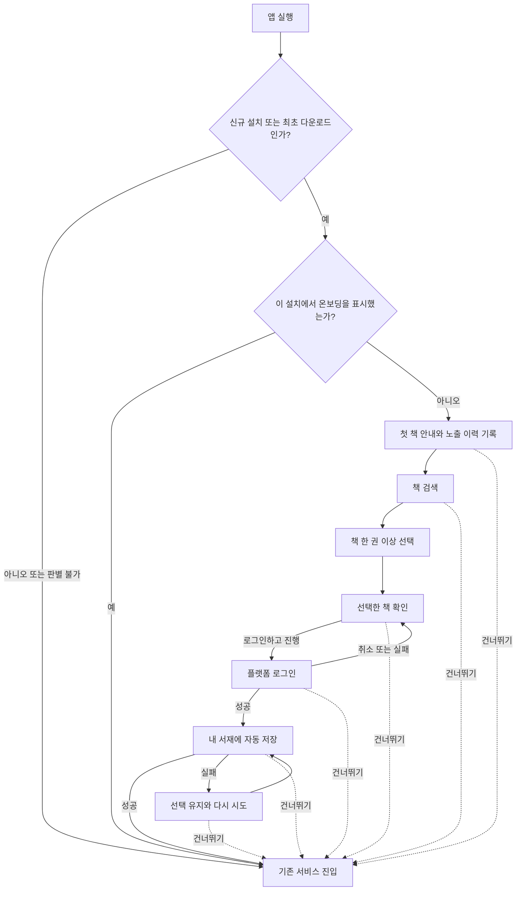

# 첫 책 선택 온보딩

## 목적과 상태

Android와 iOS에서 앱을 새로 설치한 사용자에게 첫 책 선택 흐름을 한 번 보여준다. 사용자는 어느 단계에서든 건너뛸 수 있고, 책을 선택한 뒤 로그인하면 선택한 책을 내 서재에 자동 저장한다.

- 결정일: 2026-10-14
- 변경일: 2026-10-15
- 근거: 사용자 인터뷰 `interview_20261014_063746`와 이후 확인 답변
- 이번 산출물: 요구사항 문서, Figma 화면 시안, Android와 iOS 공통 앱 구현
- 상태: 설치 기준 1회 노출과 전 화면 건너뛰기 동작 확정
- 서버 API와 계정별 노출 이력은 범위에 포함하지 않는다.

## 확정한 동작

| 상황 | 동작 |
| --- | --- |
| 적용 플랫폼 | Android와 iOS |
| 노출 대상 | 새 설치 사용자만 표시하며 기존 설치의 업데이트에는 표시하지 않는다. iOS는 App Store 최초 다운로드 버전을 기준으로 판별한다. |
| 노출 기준 | 설치별 한 번이다. Android SharedPreferences와 iOS UserDefaults에 첫 노출 이력을 기록한다. 앱 데이터 삭제, 재설치, 다른 기기에서는 다시 표시될 수 있다. |
| 기존 설치 판별 | Android는 최초 설치 시각과 최종 업데이트 시각이 다르면 기존 설치로 처리한다. iOS는 검증된 production AppTransaction의 현재 빌드와 최초 다운로드 빌드가 같을 때만 대상으로 기록한다. 이전 빌드에서 최초 다운로드한 iOS 계정의 재설치, Sandbox 및 판별 실패에서는 표시하지 않으며 판별 실패는 다음 실행에서 재확인한다. 같은 빌드에서 최초 다운로드한 계정이 그 빌드를 재설치하면 다시 표시될 수 있다. |
| 기록 시점 | 첫 온보딩 화면이 표시되면 즉시 노출 이력을 기록한다. 완료하지 않고 앱을 종료해도 다음 실행에서는 서비스로 바로 진입한다. |
| 온보딩 진행 | 책을 검색하고 한 권 이상 선택하면 로그인 선택 단계로 갈 수 있다. 모든 화면에서 건너뛰기를 선택할 수 있다. |
| 건너뛰기 | 모든 화면에서 서비스로 진입할 수 있다. 저장 시작 전에는 서재 저장 요청을 보내지 않으며, 저장 중에는 남은 요청을 취소한다. 이미 서버가 저장을 완료한 책은 삭제하지 않는다. |
| 로그인 전 책 선택 | 온보딩의 임시 선택 목록에만 담는다. 실제 서재에는 저장하지 않는다. |
| 로그인하고 진행 | 인증 성공 후 선택한 책을 내 서재에 순서대로 자동 저장한다. |
| 로그인 취소 또는 실패 | 선택한 책을 유지한다. 로그인 재시도와 건너뛰기를 다시 선택할 수 있다. |
| 로그인 성공 후 저장 실패 | 선택한 책을 유지하고 저장을 재시도할 수 있다. 건너뛰기를 선택하면 저장하지 않은 채 서비스로 진입한다. |
| 중복 저장 응답 | 이미 서재에 있는 책을 뜻하는 HTTP 409는 해당 책의 저장 성공으로 간주하고 다음 책을 처리한다. |

노출 이력, 임시 선택 목록, 실제 서재 저장 결과는 서로 다른 상태다. 노출 이력은 서버 계정과 동기화하지 않는다.

## 사용자 흐름

## 화면 시안 범위

아래 화면은 확정 동작을 표현한다. 모든 하단 진행 영역은 디자인 시스템의 `책췍/ButtonSecondary` 인스턴스로 건너뛰기를 제공한다.

| ID | 화면 또는 상태 | 주요 내용 |
| --- | --- | --- |
| ONB-01 | 첫 책 안내 | 빈 서재 미리보기, 첫 책을 고르는 이유, 책 찾기 |
| ONB-02 | 검색 전 | 검색 입력, 책 한 권 이상 선택 안내, 비활성 다음 버튼 |
| ONB-03 | 검색 결과 | 표지·제목·저자, 선택 전 책 목록 |
| ONB-04 | 책 선택 완료 | 선택 표시, 선택 개수, 활성 다음 버튼 |
| ONB-05 | 선택한 책 확인 | 선택한 책의 서재 미리보기, 로그인하고 진행, 건너뛰기, 저장 여부 안내 |
| ONB-06 | Android 로그인 | 기존 Google 로그인 컨트롤, 닫으면 선택 유지 |
| ONB-07 | iOS 로그인 | 기존 Apple·Google 로그인 컨트롤, 닫으면 선택 유지 |
| ONB-08 | 로그인 실패 후 복귀 | 선택한 책 유지, 실패 안내, 로그인 재시도와 건너뛰기 제공 |
| ONB-09 | 자동 저장 중 | 로그인 완료, 선택한 책 저장 중 표시, 중복 요청 방지 |
| ONB-10 | 저장 실패 | 선택 유지, 다시 시도와 건너뛰기 제공 |
| ONB-11 | 검색 결과 없음 | 검색어 수정 안내, 검색 입력 유지 |
| ONB-12 | 검색 실패 | 검색어 유지, 오류 안내, 다시 시도 |
| ONB-13 | 좁은 화면 검토 | 320 너비에서 로그인과 건너뛰기 배치 확인 |

검색 결과와 미리보기의 책 데이터는 Figma 기존 자산을 재사용한 예시다. 실제 검색 순위나 사용자 서재 데이터가 아니다. 성공 또는 그냥 진행 이후 도착 화면은 기존 서비스 진입 흐름에 연결하며 새로운 홈 화면을 설계하지 않는다.

## 디자인 기준

### 제작한 Figma 시안

- [복원된 전체 시안 보드](https://www.figma.com/design/tn59Thk2GRcVLkzoO8k9Sr?node-id=1141-7)
- [책 선택 행 메인 컴포넌트 세트](https://www.figma.com/design/tn59Thk2GRcVLkzoO8k9Sr?node-id=1073-387): Default, Selected
- [서재 미리보기 메인 컴포넌트 세트](https://www.figma.com/design/tn59Thk2GRcVLkzoO8k9Sr?node-id=1073-407): Empty, Selected
- [Controls의 온보딩 상태별 연결 인스턴스](https://www.figma.com/design/tn59Thk2GRcVLkzoO8k9Sr?node-id=1073-408)

### 재사용한 원본과 스타일

- 원본: [책췍 Figma](https://www.figma.com/design/tn59Thk2GRcVLkzoO8k9Sr)
- 공통 컴포넌트와 토큰: [디자인 시스템](https://www.figma.com/design/tn59Thk2GRcVLkzoO8k9Sr?node-id=901-300)
- 공통 상태별 예시: [Controls](https://www.figma.com/design/tn59Thk2GRcVLkzoO8k9Sr?node-id=905-153)
- 화면 레이아웃 참고: [발견](https://www.figma.com/design/tn59Thk2GRcVLkzoO8k9Sr?node-id=822-1084), [내 서재](https://www.figma.com/design/tn59Thk2GRcVLkzoO8k9Sr?node-id=822-1225)
- 로그인 참고: [iOS 로그인](https://www.figma.com/design/tn59Thk2GRcVLkzoO8k9Sr?node-id=925-204)
- 일반 텍스트는 Gowun Dodum Regular, 문자 아이콘은 Pretendard를 사용한다. 공급업체 로그인 컨트롤은 기존 자산의 서체·로고·색상을 유지한다.
- 흰 배경, 검정 주요 버튼, 주황 강조색, 좌우 24 여백 및 기존 변수·텍스트 스타일을 재사용한다.
- 선택 목록과 서재 미리보기는 저장 완료처럼 표현하지 않는다. 로그인 전에는 아직 저장되지 않았음을 안내한다.
- 기본 시안은 기존 모바일 원본과 같은 390 너비이며, 별도 320 너비 시안으로 좁은 화면을 검토한다.

### 공급업체 로그인 버튼 제약

Apple과 Google 버튼은 앱 공통 버튼으로 다시 그리지 않고 각 공급업체 규격을 따른다. 두 버튼의 모서리 반경이 서로 달라야 한다는 규칙은 없으며, iOS 앱에서는 둘 다 8pt로 통일할 수 있다.

- Apple: 실제 앱은 공식 `ASAuthorizationAppleIDButton`의 검정색 Continue 유형을 사용한다. Apple이 허용하는 외형 변경은 제공된 유형과 스타일 선택, `cornerRadius` 조정이며, 그 밖의 내부 로고, 문구, 색상, 글꼴은 변경하지 않는다. 현재 구현은 `cornerRadius = 8.0`과 Compose 외곽 `RoundedCornerShape(8.dp)`를 사용한다. Figma의 Apple 컴포넌트가 0으로 보이는 것은 공식 샘플 이미지를 그대로 배치한 시안 자산의 값이며, 공급업체가 강제한 모서리 값이 아니다. 근거: [Apple 공식 버튼 문서](https://developer.apple.com/documentation/authenticationservices/asauthorizationappleidbutton), `android/shared/src/iosMain/kotlin/com/chaekchaek/app/ui/common/AppleSignInButton.ios.kt`
- Google: 공식 SDK 렌더 버튼 사용을 권장하지만, 공식 자산 또는 커스텀 버튼도 허용한다. 커스텀 버튼은 표준 색상의 G 로고, 허용 문구, 색상, 글꼴, 크기와 내부 여백 등 현재 브랜드 가이드를 따라야 한다. 현재 iOS 구현은 SDK 기본 버튼 화면을 그대로 쓰지 않고 `GoogleSignInControl`을 직접 그리며 모서리 반경을 8pt로 설정한다. 근거: [Google 로그인 브랜드 가이드](https://developers.google.com/identity/branding-guidelines), `android/iosApp/Chaekchaek/ContentView.swift`
- 공통 적용: 버튼 높이와 너비, 화면 안의 외부 배치 및 8pt 모서리 통일은 가능하다. 공급업체가 소유한 내부 자산은 책췍 공통 버튼 스타일로 덮어쓰지 않는다.

2026-10-15 확인 기준으로 현재 Google 커스텀 컨트롤은 `Roboto-Bold 17`을 사용한다. 최신 Google 브랜드 가이드와 배포 시점의 공식 자산을 다시 대조하기 전에는 이 구현이 최신 규격을 모두 충족한다고 판단하지 않는다.

## 구현 단계에서 확인할 항목

아래는 새 사용자 요구가 아니라 확정 동작을 구현하기 위해 확인할 기술 사항이다.

- 설치별 노출 이력은 플랫폼 로컬 저장소에만 둔다. 책췍 서버나 책췍 계정 상태를 진입 조건으로 사용하지 않는다. iOS 신규 다운로드 판별은 App Store의 최초 다운로드 버전을 사용한다.
- 로그인 화면을 다녀오는 동작을 앱 신규 실행으로 오인해 선택을 버리지 않는다.
- 실제 서재 추가 API는 기존 계약을 재사용한다. 여러 책 저장 중 HTTP 409가 발생하면 저장된 것으로 간주하고 계속 진행한다.
- 기존 서재 추가 동작을 재사용한다. 독서 상태나 저장 API 계약을 이번 시안에서 새로 정의하지 않는다.
- 이미 로그인된 상태에서는 공급업체 로그인 화면을 다시 열지 않고 선택한 책 저장으로 바로 진행한다.
- Figma 내 공급업체 버튼은 배치 참고용이다. 실제 앱에서는 공급업체 네이티브 컨트롤과 기존 인증 흐름을 사용한다.

## 검증 기준

### 이번 문서·시안

- 확정 동작과 화면별 버튼·문구의 일치 여부
- 새 공통 요소의 메인 컴포넌트 및 Controls 인스턴스 연결
- 기존 버튼·검색창·표지·로그인 컴포넌트, 변수와 스타일 재사용
- 편집 가능한 레이어 구성, 글꼴, 잘림·겹침, 390 및 320 너비 캡처

2026-10-15 확인 결과:

- 390×844 시안 12개와 320×844 시안 1개를 제작했다.
- 세 화면 묶음의 캡처를 확인했다. 선택 미리보기의 문구와 좁은 화면 구분선을 수정한 뒤 해당 화면과 공통 레퍼런스를 다시 캡처해 확인했다.
- 13개 화면의 하단 진행 영역에 건너뛰기를 추가했다. 로그인 선택 화면의 기존 `그냥 진행`은 같은 동작이므로 `건너뛰기`로 통일했다. 390과 320 너비 캡처에서 잘림과 겹침이 없는 것을 확인했다.
- 일반 텍스트 Gowun Dodum Regular, 문자 아이콘 Pretendard Regular, 기존 Google 컨트롤의 Roboto Bold를 확인했다.
- Controls의 네 인스턴스가 각각 책 선택 행 두 상태와 서재 미리보기 두 상태의 메인 컴포넌트를 참조하는 것을 확인했다.
- 화면은 편집 가능한 텍스트, 자동 배치 프레임과 컴포넌트 인스턴스로 구성했다. 책 표지와 기존 공급업체 자산은 이미지를 재사용했다.

### 앱 구현

- 책 0권일 때 다음 단계 불가, 1권 이상일 때 진행 가능
- 모든 온보딩 상태에서 건너뛰기 가능, 저장 시작 전 건너뛰기 시 서재 저장 요청 없음
- 저장 중 건너뛰기 시 남은 요청 취소, 이미 저장 성공한 책은 유지
- 로그인 성공 시 자동 저장 후 진입
- 로그인 취소·실패 시 선택 유지 및 두 선택지 복귀
- 저장 실패 시 선택 유지, 재시도와 건너뛰기 동작
- 온보딩 중 종료 및 저장 실패 후 재실행 시 바로 진입
- 기존 설치 업데이트에서 미노출, 새 Android 설치 및 새 App Store 다운로드에서 1회 노출
- iOS 이전 빌드에서 최초 다운로드한 계정의 재설치와 판별 실패에서 미노출
- iOS 같은 빌드에서 최초 다운로드한 계정이 그 빌드를 재설치하면 재노출 가능
- 구성 변경 중 선택 및 진행 상태 유지, 중복 뒤로가기와 늦은 인증 응답의 영향 차단
- Android와 iOS의 실제 인증·저장 흐름, 접근성 및 기기 화면 검증

2026-10-15 구현 확인 결과:

- 공통 ViewModel 단위 테스트에서 선택 조건, 로그인 실패 후 선택 유지, 저장 실패 재시도, 부분 성공 도서 중복 저장 방지, 저장 중 건너뛰기 취소를 확인했다.
- Android 전체 host test와 debug APK 빌드가 통과했다.
- iPhone 17 Pro Simulator의 기본 글자 크기와 AX5에서 UI 테스트 각 6개가 통과했다. 온보딩 첫 화면과 검색 화면의 접근성 감사, 이전 화면 복귀, 기존 설치 미노출, 건너뛰기와 앱 재실행 후 미노출을 확인했다.
- iOS 기본 글자 크기 캡처에서 안전 영역, 하단 버튼, 텍스트 잘림과 겹침이 없는 것을 확인했다.
- 검색 입력의 대량 붙여넣기와 중간 삽입 커서를 검증하는 Android UI 테스트를 추가했다. 실행 제한으로 실제 IME 조합과 붙여넣기는 확인하지 못했다.
- 공통 기반 MemberSettingsViewModelTest에서 Main dispatcher 정리 시 간헐 실패를 관찰했으며 재실행에서는 통과했다.
- Android 에뮬레이터는 세션 임대 후 실행 단계에서 임대 확인 훅이 현재 세션을 인식하지 못해 실제 기기 화면 검증을 수행하지 못했다.
- 실제 Google 또는 Apple 계정 인증과 운영 서버 서재 저장은 자동 테스트에서 실행하지 않았다. 인증 이후 저장 전환과 실패 복구는 공통 상태 로직 테스트로 검증했다.

Figma 시안 검증은 팀 라이브러리 게시의 증거가 아니다.

### 독립 리뷰 후 보완 (2026-10-15)

- 시스템 뒤로가기와 상단 버튼을 같은 단계 전이로 연결하고 이전 진입의 콜백은 폐기한다.
- 현재 온보딩 표시와 검색·선택·저장 진행은 ViewModelStore 소유로 보존한다. 새 프로세스는 로컬 노출 이력을 다시 읽어 이미 본 온보딩을 복원하지 않는다. 최종 소유자 해제와 건너뛰기는 진행 작업을 취소한다.
- 검색어 제한은 공통 TextFieldState와 InputTransformation의 Unicode 및 편집 구간 보존 규칙을 재사용한다. 검색·저장 인디케이터는 500ms 이후에만 표시한다.
- 책 선택 행은 Checkbox 역할과 체크 상태를 노출한다. 저장 재시도는 현재 세션 토큰을 전달하며, 건너뛰기 뒤 인증 응답은 세대 검사로 폐기한다.
- 설치 판별 근거: [Android PackageInfo](https://developer.android.com/reference/android/content/pm/PackageInfo), [Apple originalAppVersion](https://developer.apple.com/documentation/storekit/apptransaction/originalappversion). iOS App Store production 다운로드 판별은 Simulator UI 테스트로 검증할 수 없다.
