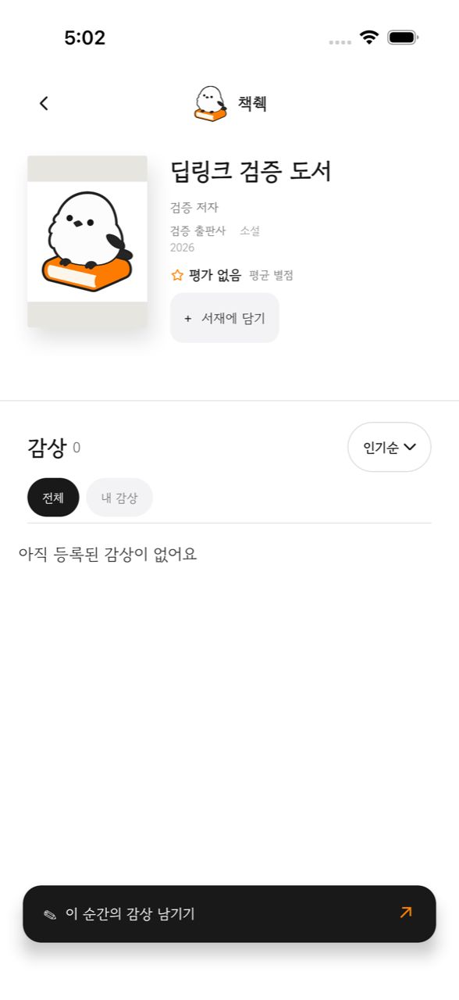
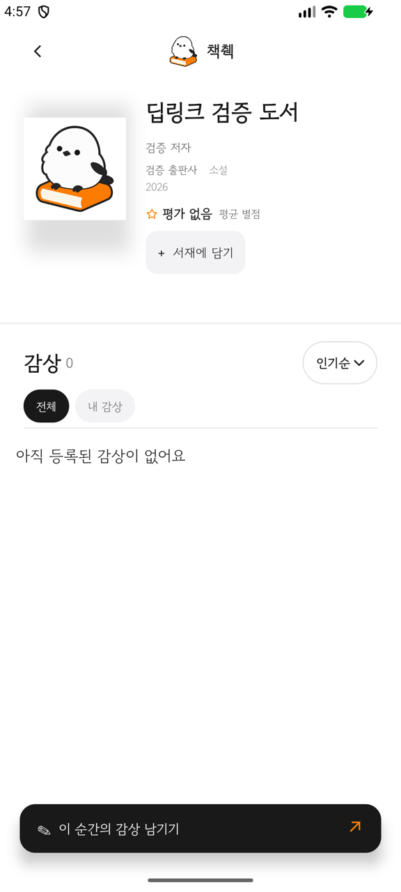
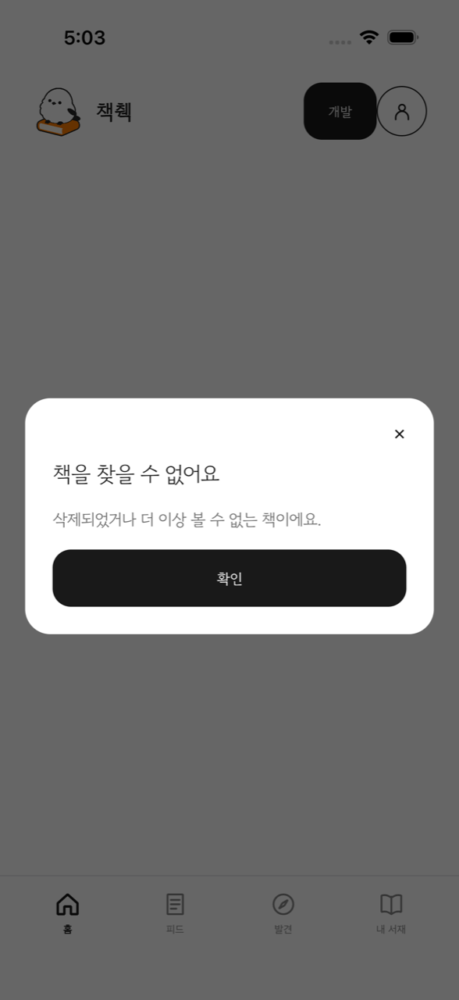
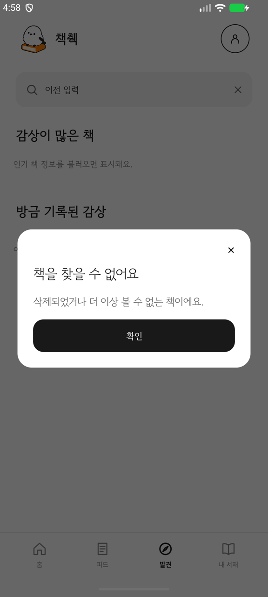
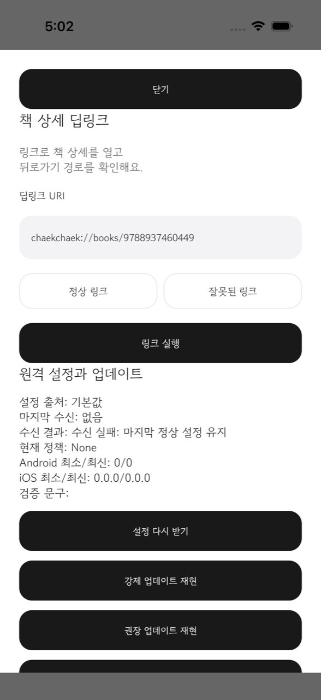

# 외부 진입점과 인증 만료 처리 요구사항 제출 문서

2026-11-12 작성. 레벨4 요구사항 5(외부 진입점)와 6(인증 만료 처리)의 제출 증거를 모은다. 요구사항 5는 2026-11-12에 양 플랫폼 자동화 검증까지 마쳤고, 요구사항 6은 개발 서버 기기 시연이 남아 있다.

- 인증 만료: [이슈 #707](https://github.com/woowacourse-teams/2026-chaekchaek/issues/707), [Draft PR #708](https://github.com/woowacourse-teams/2026-chaekchaek/pull/708), 작업 브랜치 `707-auth-expiry-recovery`
- 인증 만료 정책 원문: [모바일 인증 만료와 세션 복구 정책](../mobile-auth-expiry-policy.md)
- 외부 진입점: [이슈 #692](https://github.com/woowacourse-teams/2026-chaekchaek/issues/692), [Draft PR #693](https://github.com/woowacourse-teams/2026-chaekchaek/pull/693), 작업 브랜치 `692-book-detail-deeplink`
- 외부 진입점 기준 문서: [모바일 책 상세 딥링크](https://github.com/woowacourse-teams/2026-chaekchaek/blob/692-book-detail-deeplink/docs/mobile-book-detail-deeplinks.md) (PR #693 브랜치)

이 문서는 수집한 증거와 아직 확보하지 못한 증거를 구분한다. 미확인 항목은 확인 전까지 완료로 쓰지 않는다.

## 요구사항 6. 인증 만료 처리

### 완료 조건별 증거 현황

| 완료 조건 | 증거 | 상태 |
| --- | --- | --- |
| 상황별 서버 응답과 앱 동작을 백엔드와 합의해 문서화 | [정책 문서 2절](../mobile-auth-expiry-policy.md#2-서버-응답-계약), [개발 서버 응답 기록](assets/auth-expiry/dev-server-auth-responses.txt) | 문서화와 서버 응답 대조는 완료. 백엔드 합의 기록은 미확인 |
| Access 토큰 만료 후 사용자 모르게 계속 사용(Silent Refresh) | 호스트 테스트 `SilentRefreshClientTest` | 자동 테스트 통과. 개발 서버 기기 시연 미실행 |
| 동시 만료 응답에도 갱신 1회 | 호스트 테스트, 개발자 도구 `재발급 요청 N회` 표시 | 자동 테스트 통과. 기기 시연 미실행 |
| Refresh 폐기 후 로그인 화면, 재로그인 후 원래 화면 복귀 | 호스트 테스트 `AuthViewModelTest` | 자동 테스트 통과. 기기 시연 미실행 |
| 갱신 중 네트워크 단절에도 로그아웃 없음 | 호스트 테스트 `SilentRefreshClientTest` | 자동 테스트 통과. 기기 시연 미실행 |
| (권장) 개발자 도구에서 만료 시각 확인, 강제 만료, Refresh 폐기 | `AuthDeveloperContent` | 구현 완료. 기기 캡처 미확보 |

### 서버 응답 계약 확인

2026-11-12 06:25 UTC에 개발 서버 `https://dev-api.chaekchaek.com`에 임의 토큰을 보내 응답을 기록했다. 원문은 [개발 서버 응답 기록](assets/auth-expiry/dev-server-auth-responses.txt)에 있다.

| 요청 | 응답 | 앱 처리 |
| --- | --- | --- |
| 인증이 필요한 API에 만료·무효 Access 토큰 | `401 UNAUTHORIZED` | 재발급 후 원래 요청 1회 재전송 |
| 재발급에 무효 Refresh 토큰 | `401 INVALID_REFRESH_TOKEN` | 로컬 토큰 정리, 작업 보존, 로그인 안내 |
| 로그아웃(폐기)에 존재하지 않는 Refresh 토큰 | `204` | 폐기 성공 응답만으로는 실제 폐기를 판단할 수 없음 |

폐기된 실제 Refresh 토큰으로 재발급할 때의 `401 UNUSABLE_REFRESH_TOKEN`과 권한 없음 `403 FORBIDDEN`은 백엔드 소스에서만 확인했고 개발 서버 응답으로는 기록하지 못했다. 개발 서버에서 토큰 수명을 짧게 바꾸는 방법은 확인하지 못했고, 앱의 개발자 도구 강제 만료로 대신한다.

### 자동 테스트 증거

- 재발급 요청 수 표시를 추가한 로컬 소스에서 `:shared:testAndroidHostTest` 512개가 통과했고 `:app:assembleDebug`, `:shared:compileKotlinIosSimulatorArm64`가 통과했다.
- 최종 리뷰 반영 커밋 `14559ebb`의 [GitHub Actions `Build, test, lint`](https://github.com/woowacourse-teams/2026-chaekchaek/actions/runs/43166157773)가 통과했다.
- 독립 리뷰 2회: [1차 인라인 리뷰](https://github.com/woowacourse-teams/2026-chaekchaek/pull/708#pullrequestreview-5869623435), [2차 인라인 리뷰](https://github.com/woowacourse-teams/2026-chaekchaek/pull/708#pullrequestreview-5869791082).

| 테스트 | 확인 내용 |
| --- | --- |
| `SilentRefreshClientTest` | 401 후 갱신과 재전송, 재전송 후에도 401이면 1회로 중단, 인증 엔드포인트 미개입, Refresh 폐기 시 401 전달, 갱신 완료 뒤 늦은 401의 토큰 재사용, 갱신 연결 오류 후 같은 세션 재시도, 이전 세션 응답 미재전송, 403은 갱신하지 않음 |
| `AuthViewModelTest` | 만료 회원 범위의 재로그인과 대기 작업 재개, 다른 회원 로그인 시 대기 작업 차단, 닉네임 저장 중 토큰 회전, 개발자 도구 강제 만료와 폐기, 동시 갱신을 재발급 요청 1회로 계산 |

### 개발 서버 시연 계획

Android와 iOS에서 각각 development Debug 빌드로 실행한다. 로그인은 사용자가 직접 진행한다. 각 단계의 개발자 도구 화면과 결과 화면을 캡처해 `assets/auth-expiry/`에 저장한다.

| 순서 | 시나리오 | 확인할 결과 | Android | iOS |
| --- | --- | --- | --- | --- |
| 1 | 로그인 후 개발자 도구에서 남은 시간과 재발급 요청 수 확인 → 강제 만료 → 홈 이동 | 오류 없이 홈 표시, 재발급 요청 수가 1만 증가 | 미실행 | 미실행 |
| 2 | 감상 또는 닉네임 입력 중 강제 만료 → 저장 | 오류 없이 저장 | 미실행 | 미실행 |
| 3 | 입력 중 Refresh 서버 폐기 → 저장 → 같은 계정 재로그인 | 로그인 안내 후 원래 화면과 초안 유지, 저장 완료 | 미실행 | 미실행 |
| 4 | 3번 상태에서 다른 계정으로 로그인 | 이전 계정의 대기 작업 미제출 | 미실행 | 미실행 |
| 5 | 강제 만료 → 기기 네트워크 차단 → 요청 → 연결 복구 후 재시도 | 로그아웃 없음, 재시도 성공 | 미실행 | 미실행 |

### 검증 기록

- 2026-11-12: 개발자 도구에 `재발급 요청: N회 (앱 실행 후)` 표시를 추가했다. 값은 `AuthSession`이 서버로 재발급 요청을 보낼 때마다 1씩 늘린다. 만료 30초 전의 사전 갱신도 포함하므로 시연에서는 조작 전후의 증가량을 본다.
- 2026-11-12: 첫 전체 호스트 테스트에서 변경과 무관한 `BookDetailViewModelTest`의 `담기를 반복해도 삭제하지 않고 명시적 삭제만 서재를 지운다`가 `Dispatchers.Main` 예외로 1회 실패했다. 같은 소스에서 해당 클래스 단독 실행과 `--rerun-tasks` 전체 실행이 모두 통과해 재현되지 않았다. 원인은 미확인이다.

### 확보하지 못한 증거

- 백엔드와의 합의 기록. 서버가 토큰을 회전한 직후 응답만 유실된 경우의 복구 계약도 미확인이다.
- Android와 iOS 개발 서버 시연 캡처 전부.
- iOS `LoginRequiredSheetUITests/testMissingNicknameCannotDismissAndCompletesLoginAfterSave` 최종 커밋 재실행 결과.

## 요구사항 5. 외부 진입점

딥링크 `chaekchaek://books/{isbn13}`로 책 상세에 들어온다. 도메인 인증이 필요한 Android App Link는 범위에서 제외했다.

### 완료 조건별 증거 현황

| 완료 조건 | 증거 | 상태 |
| --- | --- | --- |
| 앱 밖에서 특정 화면으로 들어오는 경로 1개 이상 | Android Intent 필터와 iOS URL 수신, 아래 자동화 실행 | 합성 API로 양 플랫폼 검증 완료. 실제 서버 응답으로는 미실행 |
| 진입 경로별 뒤로가기 목적지 정의와 동작 | 기준 문서의 사용자 결정, 콜드는 홈·실행 중과 백그라운드는 이전 화면 복귀 테스트 | 양 플랫폼 검증 완료 |
| 비로그인, 잘못되었거나 삭제된 대상 처리 | URI 형식 검증, 404·503 공통 오류 안내 테스트, 비로그인 상세 열람 | 오류 처리는 양 플랫폼 검증 완료. 딥링크 진입 뒤 실제 로그인을 거쳐 작업을 재개하는 흐름은 미검증 |
| (권장) 개발자 도구에서 딥링크 실행 | Android `DeveloperToolsActivity`, iOS 개발자 화면 | 실제 플랫폼 URL 경로로 실행하는 테스트 양 플랫폼 통과 |

### 실행 증거

모든 실행은 로컬 합성 API(`android/scripts/book-deeplink-fixture.py`)를 사용했다. 기준 소스는 PR #693의 `54c5ba06`이다.

| 플랫폼 | 기기 | 결과 |
| --- | --- | --- |
| iOS | iPhone 17 Pro, iOS 26.2 Simulator | `BookDeepLinkUITests` 5건을 3회 반복해 15회 모두 통과 |
| Android | `medium_phone` AVD, Android 17(API 37) | `BookDeepLinkInteractionTest` 9건 통과 |
| 공통 | `:shared:testAndroidHostTest` | 515개 통과 |

- Android 계측 APK는 `an-develop`의 기존 계측 테스트가 #704 모델 변경으로 컴파일되지 않아, [PR #724](https://github.com/woowacourse-teams/2026-chaekchaek/pull/724)의 수정 `141065d8`을 임시 체크아웃에만 얹어 빌드했다.
- 2026-11-12 이어받기 중 수정한 결함: 콜드 진입 중 링크 조회 효과가 다시 시작되면 같은 책을 두 번 조회했다(iOS 3회 중 1회, 75ms 간격). 조회를 `BookDeepLinkViewModel` 수명의 공유 요청으로 바꿔 1회로 만들었다. 새 테스트는 수정 전 코드에서 `expected:<1> but was:<2>`로 실패했다.
- iOS에서 `simctl openurl`로 실행 중인 앱에 링크를 보내면 시스템이 "'책췍'에서 열겠습니까?"를 묻는 경우가 있어, UI 테스트가 확인창이 나타날 때만 `열기`를 누르도록 고쳤다.

| 화면 | iOS | Android |
| --- | --- | --- |
| 콜드 진입 후 책 상세 |  |  |
| 삭제된 책 링크 |  |  |
| 개발자 도구 딥링크 실행 |  | 캡처 없음 |

### 확보하지 못한 증거

- 딥링크로 진입한 뒤 실제 공급업체 로그인을 거쳐 대기 작업을 재개하는 흐름.
- iOS 시스템 프로세스 종료 후 딥링크와 백스택 복원. 저장 경로가 구현되지 않았다.
- 실제 기기와 개발·운영 서버 응답.
