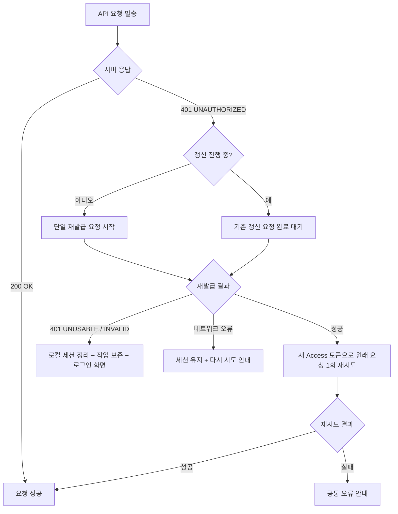

# 모바일 인증 만료와 세션 복구 정책

2026-11-11 작성. [이슈 #707](https://github.com/woowacourse-teams/2026-chaekchaek/issues/707)의 기준 문서다.

## 1. 목적

Access 토큰 만료 시 사용자 개입 없이 조용히 토큰을 재발급(Silent Refresh)하고 원래 요청을 재시도하여 앱 사용 흐름을 유지한다. 다중 동시 요청 환경에서 중복 갱신으로 인한 Refresh Token Rotation 충돌을 방지하며, Refresh 토큰이 폐기된 경우에도 작업 위치와 초안을 보존한 뒤 재로그인 후 복구한다.

## 2. 서버 응답 계약 (백엔드 합의)

백엔드 인증 모바일 API 계약(`origin/be-dev`) 기준:

| 상황 | HTTP 상태 코드 | 에러 코드 / 응답 본문 | 앱의 처리 정책 |
| --- | --- | --- | --- |
| Access 토큰 만료 | `401 Unauthorized` | `UNAUTHORIZED` | 조용히 갱신(Silent Refresh) 후 실패했던 요청 1회 자동 재시도 |
| Refresh 토큰 만료·폐기 | `401 Unauthorized` | `UNUSABLE_REFRESH_TOKEN` | 로컬 세션 정리, 로그인 UI 표시, 하던 작업·위치 보존 후 복구 |
| 유효하지 않은 Refresh 토큰 | `401 Unauthorized` | `INVALID_REFRESH_TOKEN` | 로컬 세션 정리, 로그인 UI 표시 |
| 권한 없음 (로그인은 정상) | `403 Forbidden` | `FORBIDDEN` | 갱신하지 않음. 접근 권한 없음 안내 |
| 네트워크 오류 | 타임아웃 / 연결 실패 | (응답 없음) | 세션 보존 (로그아웃 금지), 재시도 옵션 제공 |

- **Refresh Token Rotation**: `POST /api/v1/auth/mobile/reissue` 호출 시 이전 Refresh 토큰은 즉시 무효화되며, 새로운 Access 토큰과 Refresh 토큰 쌍이 발급된다.
- **Refresh 토큰 수동 폐기**: `POST /api/v1/auth/mobile/logout`에 Refresh 토큰을 전달하여 서버 세션을 폐기할 수 있다 (개발자 도구 시연용 활용).

## 3. 앱 동작 흐름

### 3.1. 다중 동시 401 중복 갱신 방지 (Single Flight Reissue)
- 여러 API 요청이 동시에 401을 받더라도 서버로 발송되는 `reissue` 요청은 반드시 단 1회만 실행되어야 한다.
- `AuthSession`의 `Mutex`와 `Deferred`를 활용하여 후속 요청들은 첫 번째 갱신 결과를 대기하고 공유한다. 이를 통해 Rotation 규칙에 따른 Refresh 토큰 무효화 충돌을 방지한다.

### 3.2. 갱신 포기 조건
- 새 토큰으로 원래 요청을 재시도했음에도 다시 401이 반환되는 경우, 무한 갱신 루프를 방지하기 위해 재시도를 1회로 제한하고 즉시 중단한다.

### 3.3. 위치 및 입력 보존 (State Preservation)
- Refresh 토큰 만료 또는 서버 폐기로 재로그인이 필요한 경우:
  - 현재 열려 있던 화면 스택, 스크롤 위치, 입력 필드 텍스트 및 임시 저장 초안을 초기화하지 않는다.
  - 로그인 완료 시 사용자가 머물던 화면으로 즉시 복귀한다.

## 4. 개발자 도구 디버그 기능

개발자 도구 화면(`DeveloperToolsActivity` 및 iOS DeveloperTools)에서 다음 조작을 지원한다:
- **토큰 정보 확인**: 현재 Access 토큰 및 Refresh 토큰의 만료 일시(남은 시간) 표시.
- **Access 토큰 강제 만료**: 현재 Access 토큰의 유효 기간을 즉시 만료 상태로 전환하여 다음 API 호출 시 Silent Refresh 및 재시도 동작 검증.
- **Refresh 토큰 강제 폐기**: 서버의 `POST /api/v1/auth/mobile/logout`을 호출하여 앱의 로컬 세션을 유지한 채 서버 토큰만 무효화하고, 이후 API 호출 시 로그인 유도 및 위치 복귀 동작 검증.

## 5. 구현 및 검증 상태

작업 브랜치 `707-auth-expiry-recovery` 기준.

| 구분 | 상태 |
| --- | --- |
| 정책 문서 작성 | 완료 (이 문서) |
| Ktor Client 401 Silent Refresh 인터셉터 | 완료 (`AuthenticatedHttpClient.kt`) |
| 동시 401 요청 단일 재발급 공유 | 완료 (`AuthSession.kt`, Single Flight) |
| Refresh 폐기 시 세션 정리 및 작업 보존 복귀 | 완료 (`AuthViewModel.kt`, 세션 정리 및 상태 보존) |
| 개발자 도구 토큰 만료-폐기 기능 | 완료 (`AuthDeveloperContent.kt`, Android 및 iOS 연계) |
| 단위 테스트 검증 (`:shared:testAndroidHostTest`) | 완료 (504개 테스트 전체 통과) |
