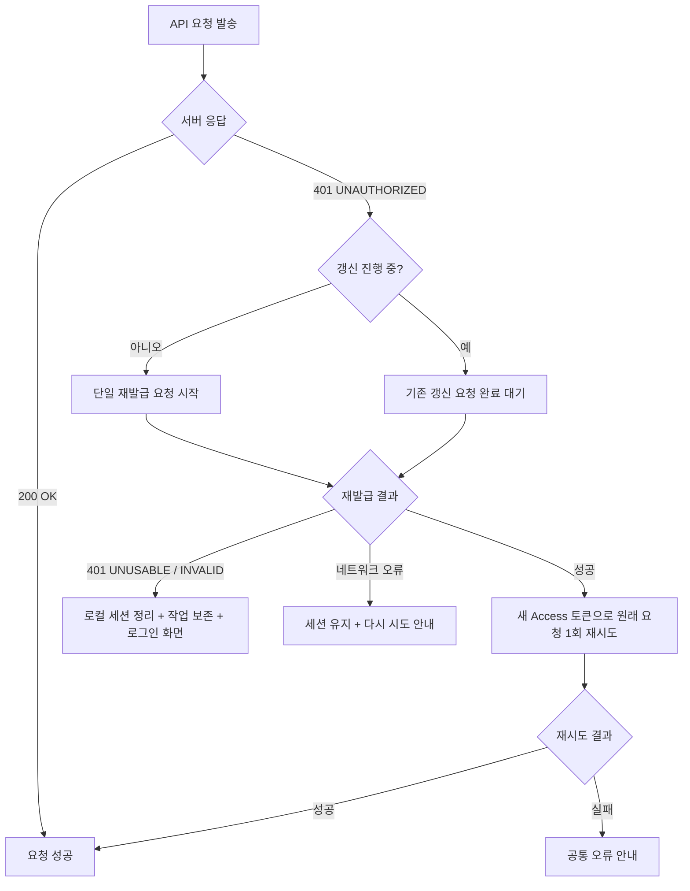

# 모바일 인증 만료와 세션 복구 정책

2026-11-11 작성. [이슈 #707](https://github.com/woowacourse-teams/2026-chaekchaek/issues/707)의 기준 문서다.

## 1. 목적

Access 토큰 만료 시 사용자 개입 없이 조용히 토큰을 재발급(Silent Refresh)하고 원래 요청을 재시도하여 앱 사용 흐름을 유지한다. 다중 동시 요청 환경에서 중복 갱신으로 인한 Refresh Token Rotation 충돌을 방지하며, Refresh 토큰이 폐기된 경우에도 작업 위치와 초안을 보존한 뒤 재로그인 후 복구한다.

## 2. 서버 응답 계약

2026-11-12에 개발·운영 OpenAPI와 백엔드 `be-dev@b8d26f52`의 `AuthTokenService`, `RestAuthenticationEntryPoint`, `ApiExceptionHandler`를 대조했다. 배포된 두 OpenAPI는 재발급의 200과 400, 폐기의 204와 400을 문서화한다. 재발급 401의 오류 코드와 회전 동작은 백엔드 소스에서 확인했다. 별도의 백엔드 합의 기록과 개발 서버 계정 시연은 확인이 필요하다. [개발 OpenAPI](https://dev-api.chaekchaek.com/docs/openapi3.yaml) · [운영 OpenAPI](https://api.chaekchaek.com/docs/openapi3.yaml)

| 상황 | HTTP 상태 코드 | 에러 코드 / 응답 본문 | 앱의 처리 정책 |
| --- | --- | --- | --- |
| Access 토큰 만료 | `401 Unauthorized` | `UNAUTHORIZED` | 조용히 갱신(Silent Refresh) 후 실패했던 요청 1회 자동 재시도 |
| Refresh 토큰 만료·폐기 | `401 Unauthorized` | `UNUSABLE_REFRESH_TOKEN` | 저장한 인증 토큰 정리, 로그인 안내, 작업과 위치 보존 |
| 유효하지 않은 Refresh 토큰 | `401 Unauthorized` | `INVALID_REFRESH_TOKEN` | 저장한 인증 토큰 정리, 로그인 안내, 작업과 위치 보존 |
| 권한 없음 (로그인은 정상) | `403 Forbidden` | `FORBIDDEN` | 갱신하지 않음. 접근 권한 없음 안내 |
| 네트워크 오류 | 타임아웃 / 연결 실패 | (응답 없음) | 세션 보존 (로그아웃 금지), 재시도 옵션 제공 |

- **Refresh Token Rotation**: `POST /api/v1/auth/mobile/reissue` 호출 시 이전 Refresh 토큰은 즉시 무효화되며, 새로운 Access 토큰과 Refresh 토큰 쌍이 발급된다.
- **Refresh 토큰 수동 폐기**: `POST /api/v1/auth/mobile/logout`에 Refresh 토큰을 전달하여 서버 세션을 폐기할 수 있다 (개발자 도구 시연용 활용).

## 3. 앱 동작 흐름

### 3.1. 다중 동시 401 중복 갱신 방지 (Single Flight Reissue)
- 여러 API 요청이 동시에 401을 받더라도 서버로 발송되는 `reissue` 요청은 반드시 단 1회만 실행되어야 한다.
- 각 요청은 발송 시점의 인증 세션과 재발급 결과를 공유한다. 이전 토큰의 401이 갱신이 끝난 뒤 도착해도 같은 세션의 최신 Access 토큰으로 한 번만 다시 보낸다. 발송한 세션이 교체된 요청은 취소한다.
- 연결 실패 시 저장한 토큰을 유지하며, 사용자의 다음 요청으로 다시 재발급할 수 있다. 서버에서 회전한 뒤 응답만 유실된 경우의 복구는 서버 계약에서 확인하지 못했다.

### 3.2. 갱신 포기 조건
- 새 토큰으로 원래 요청을 재시도했음에도 다시 401이 반환되는 경우, 무한 갱신 루프를 방지하기 위해 재시도를 1회로 제한하고 즉시 중단한다.

### 3.3. 위치 및 입력 보존 (State Preservation)
- 화면은 로그인 때 확인한 회원과 로컬 세션 식별자로 작업을 유지한다. 실제 토큰은 HTTP 요청에 연결할 때만 사용한다.
- Refresh 토큰 만료 또는 서버 폐기 시 실제 토큰을 정리하고 기존 공통 오류창에서 로그인을 안내한다. 같은 회원으로 로그인하면 화면과 초안을 유지한 채 대기 중이던 작업을 이어간다. 다른 회원의 로그인으로 기존 작업을 제출하지 않는다.
- 로그인 안내에서 선택한 작업은 같은 회원 인증이 끝나면 이어간다. 같은 회원의 다른 만료 오류에는 다시 시도 버튼을 제공하고, 이전 회원의 오류는 현재 회원 화면에서 제거한다.

## 4. 개발자 도구 디버그 기능

Android와 iOS의 개발자 도구에서 앱이 현재 사용하는 인증 세션을 확인하고 조작한다.
- **토큰 정보 확인**: 현재 Access 토큰 및 Refresh 토큰의 만료 일시(남은 시간) 표시.
- **재발급 요청 수**: 앱 실행 후 서버로 보낸 재발급 요청 수를 표시한다. 만료 30초 전 사전 갱신도 포함하므로, 동시 401 시연에서는 조작 전후의 증가량이 1인지 확인한다.
- **Access 토큰 강제 만료**: 현재 Access 토큰의 유효 기간을 즉시 만료 상태로 전환하여 다음 API 호출 시 Silent Refresh 및 재시도 동작 검증.
- **Refresh 토큰 강제 폐기**: 서버의 `POST /api/v1/auth/mobile/logout`을 호출하여 앱의 로컬 세션을 유지한 채 서버 토큰만 무효화하고, 이후 API 호출 시 로그인 유도 및 위치 복귀 동작 검증.

## 5. 구현 및 검증 상태

- `SilentRefreshClientTest`는 1회 재전송, 지연 401, 일시적 갱신 실패, 세션 교체, 403, 만료 오류의 회원 범위, 개발자 폐기 중 갱신 대기를 다룬다. `AuthViewModelTest`는 닉네임 저장 중 토큰이 회전해도 로그인과 대기 작업을 완료하는지, 동시 갱신을 재발급 요청 1회로 세는지 확인한다.
- 제출용 증거 현황과 개발 서버 응답 기록은 [외부 진입점과 인증 만료 처리 제출 문서](level4-submission/auth-expiry-and-deep-link.md)에 모은다.
- 개발 서버에서 Android와 iOS 각각 확인할 항목은 저장 중 조용한 갱신, 동시 401의 서버 재발급 횟수, Refresh 폐기 후 같은 회원의 입력·위치 복구, 다른 회원 로그인 시 대기 작업 차단, 재발급 중 연결 실패와 재시도다. 개발자 도구에 진입만 했을 때 재발급이 발생하는지도 확인한다.
